<div align="center">

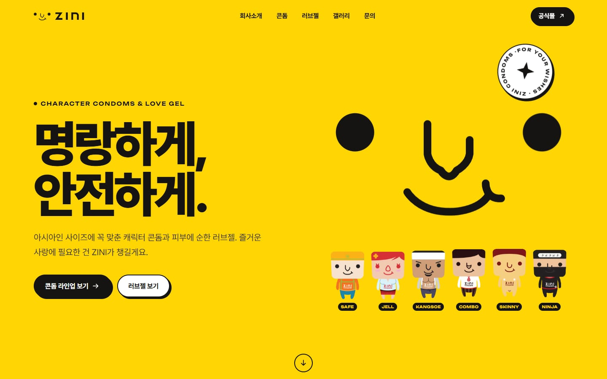

# ZINI 지니 — 브랜드 사이트 리뉴얼

**캐릭터 콘돔 & 러브젤 브랜드 ZINI의 2020년 jQuery 사이트를, 디자인부터 코드까지 처음부터 다시 만들었습니다.**

[**tjsrjs8282.github.io/zini**](https://tjsrjs8282.github.io/zini/) · [2020 원본](https://tjsrjs8282.github.io/zini/legacy/) · Redesign by [GEONY WORKS](https://tjsrjs8282.github.io/portfolio/)


</div>

---

## Before → After

|              | 2020 (원본, `legacy/`)                                                 | 2026 (리뉴얼)                                                                              |
| ------------ | ---------------------------------------------------------------------- | ------------------------------------------------------------------------------------------ |
| 디자인       | 템플릿 그대로 — "WELCOME TO SPART", 메인에만 Lorem ipsum 16곳          | 캐릭터 대표색으로 만든 디자인 시스템, 원본 상세 이미지에서 확인한 실제 제품 정보로 쓴 카피 |
| 스택         | HTML 10장 + jQuery + Bootstrap 4 + Swiper 3 + 플러그인(CDN)            | Astro 7 · TypeScript · 레이어로 나눈 자체 CSS · PhotoSwipe 5(갤러리에서만)                 |
| 반응형       | 데스크톱 위주, 첫 화면 문구가 캐릭터 그림 위에 겹침                    | 375px부터 와이드까지 유동 타이포 · 휴대폰 전용 가로 카드 · 전체 화면 메뉴                  |
| 메인 첫 로드 | **7.3 MB** · 요청 82개                                                 | **161 KB** · 요청 13개 (gzip)                                                              |
| 글꼴         | Google Fonts 웹폰트 전체                                               | 사이트에 쓰인 619자만 담은 Pretendard 94 KB + Unbounded 21 KB (가변 굵기)                  |
| 이미지       | 원본 JPG·PNG 그대로(상세 이미지 한 장 2.3 MB)                          | AVIF·WebP 반응형 `srcset`, 화면 밖 이미지는 지연 로딩                                      |
| 접근성       | `javascript:void(0)` 링크 메뉴, 확대 금지, `main` 없음, 이름 없는 링크 | 랜드마크 · 스킵 링크 · 네이티브 `<dialog>` · 키보드 탭 · 모션 줄이기 · 대비 4.5:1 이상     |
| 문의 폼      | `<form action="">` — 누르면 새로고침만 되고 어디에도 가지 않음         | 인라인 검증 + 데모 모드(실제 전송 없음), 전송 주소를 넣으면 실제로 보냄                    |

**Lighthouse 13** (2026-11-05 · 같은 PC에서 GitHub Pages처럼 gzip으로 서비스한 빌드 결과를 측정)

|                     | Performance                 | Accessibility | Best Practices | SEO     |
| ------------------- | --------------------------- | ------------- | -------------- | ------- |
| 2020 · 데스크톱     | 61                          | 64            | 77             | 82      |
| **2026 · 데스크톱** | **100** (LCP 0.3 s · CLS 0) | **100**       | **100**        | **100** |
| 2020 · 모바일       | 41 (LCP 26.1 s · CLS 0.63)  | 68            | 73             | 82      |
| **2026 · 모바일**   | **99** (LCP 1.0 s · CLS 0)  | **100**       | **100**        | **100** |

서브 페이지 9개도 모두 접근성 · 권장사항 · SEO 100, 성능은 데스크톱 100 / 모바일 97~100입니다.

<table>
  <tr>
    <td width="50%">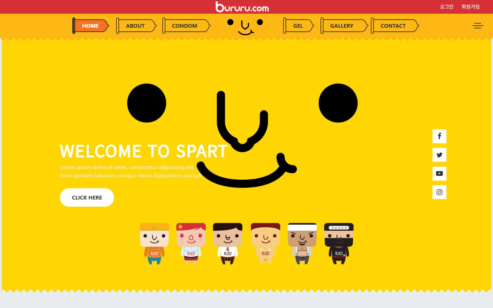<br><sub>2020 · 메인</sub></td>
    <td width="50%"><br><sub>2026 · 메인 — 마우스를 따라 움직이는 눈</sub></td>
  </tr>
  <tr>
    <td>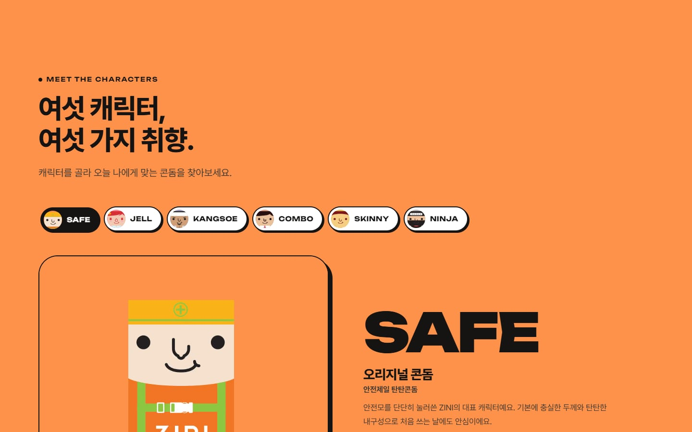<br><sub>캐릭터 고르기 — 고른 캐릭터 색으로 섹션 전체가 바뀜</sub></td>
    <td>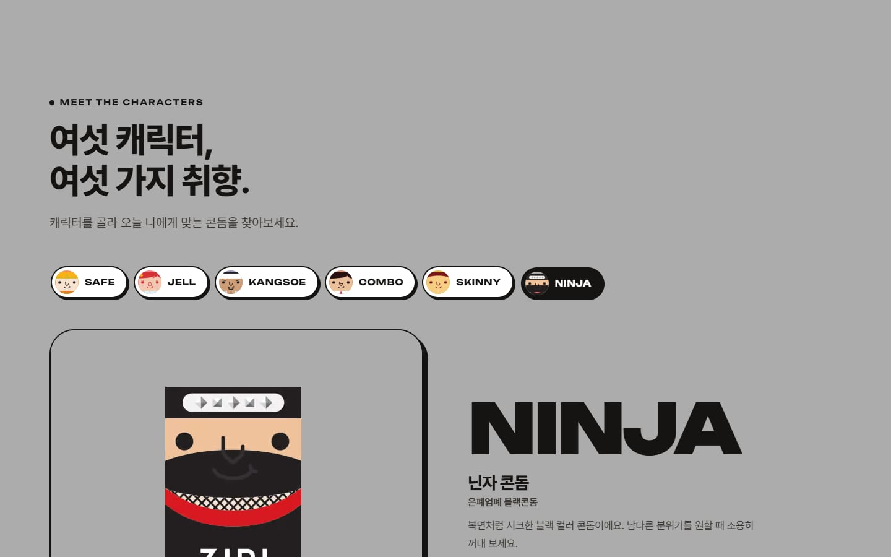<br><sub>NINJA를 고르면 회색으로</sub></td>
  </tr>
  <tr>
    <td>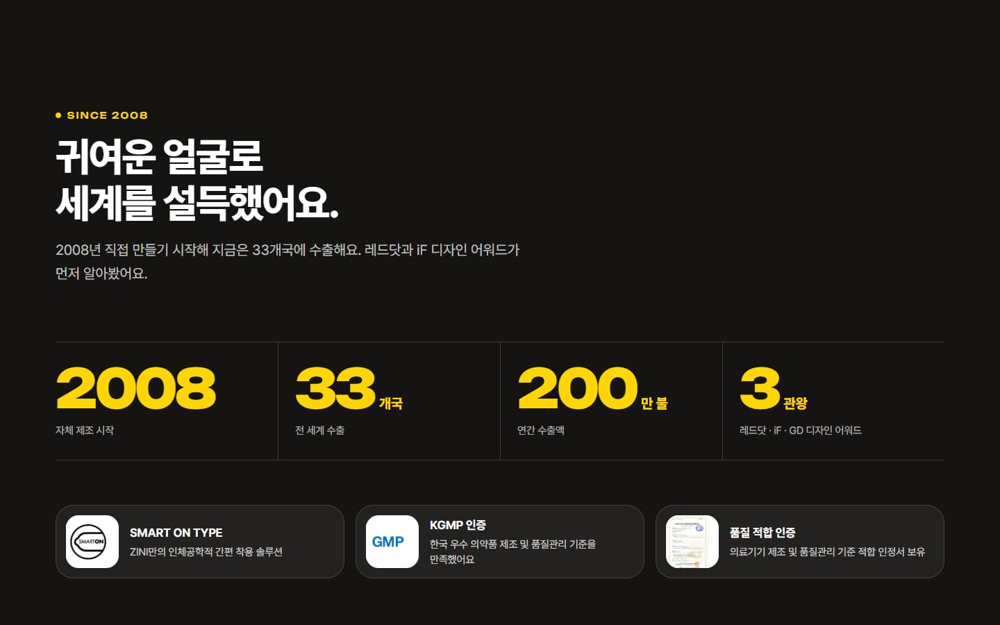<br><sub>숫자가 화면에 들어오면 세어 올라감</sub></td>
    <td>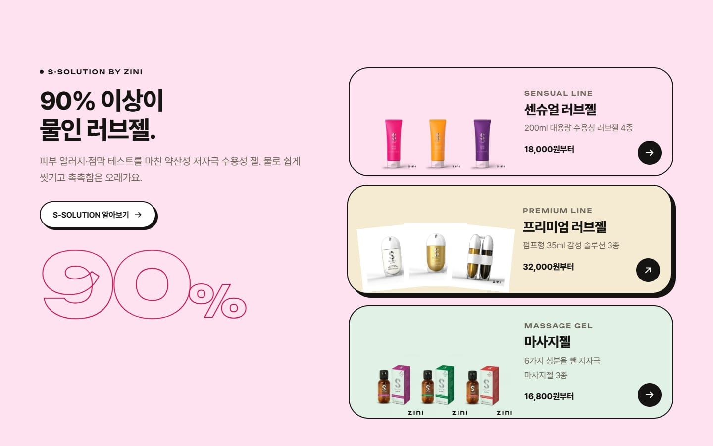<br><sub>S-SOLUTION — 흰 배경 제품 사진을 라인 색에 섞음(multiply)</sub></td>
  </tr>
  <tr>
    <td>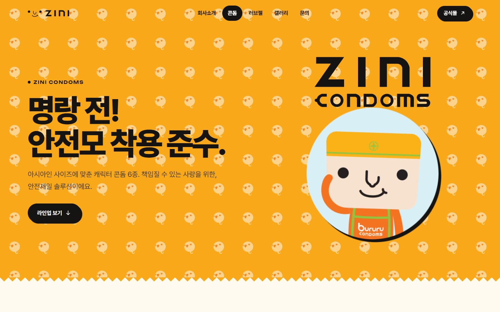<br><sub>콘돔 — 원본 SVG에서 살린 워드마크·얼굴 패턴</sub></td>
    <td>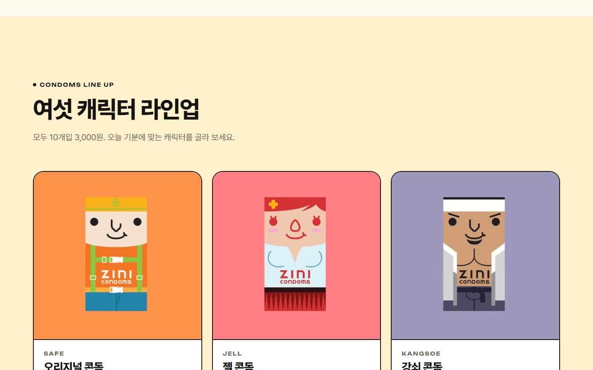<br><sub>패키지 사진 배경색 = 카드 색</sub></td>
  </tr>
  <tr>
    <td>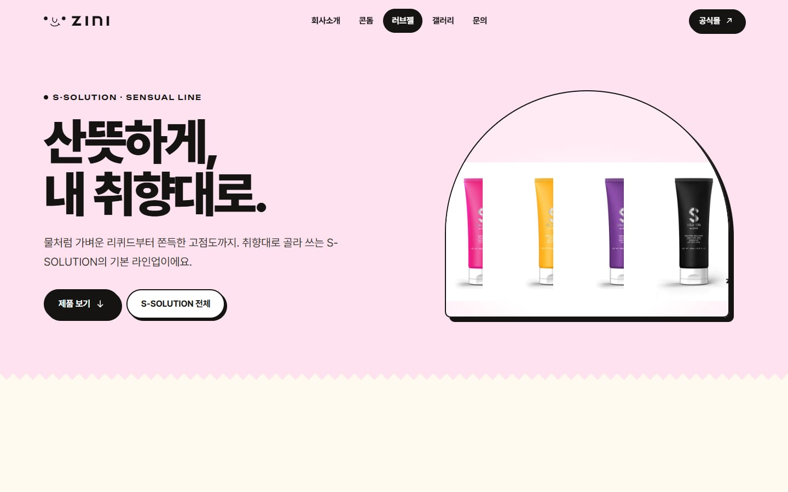<br><sub>러브젤 상세 — 진열대처럼 놓은 제품</sub></td>
    <td>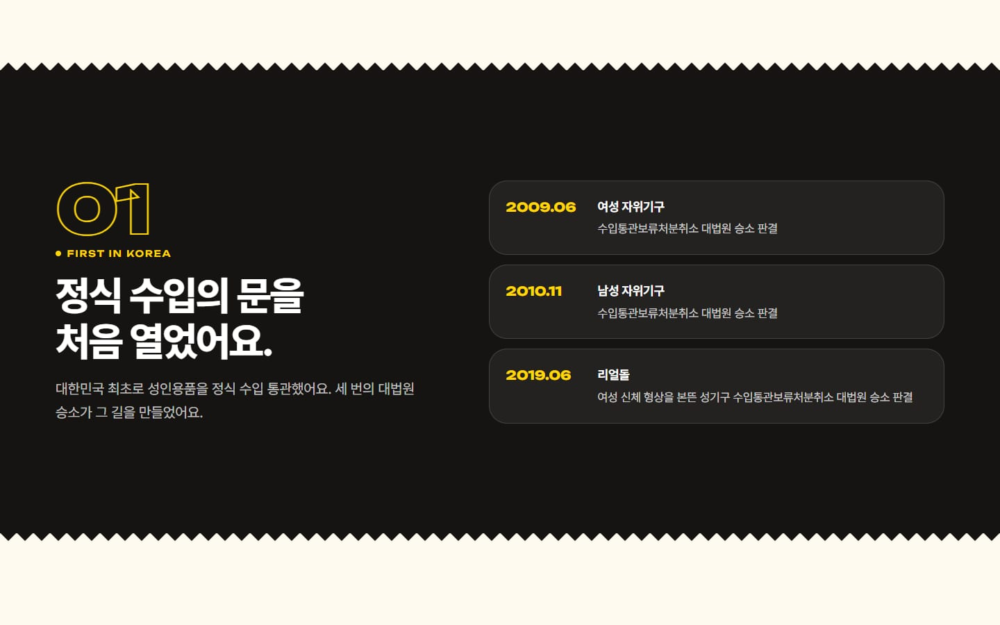<br><sub>회사소개 — 챕터별로 다시 정리한 긴 원고</sub></td>
  </tr>
  <tr>
    <td>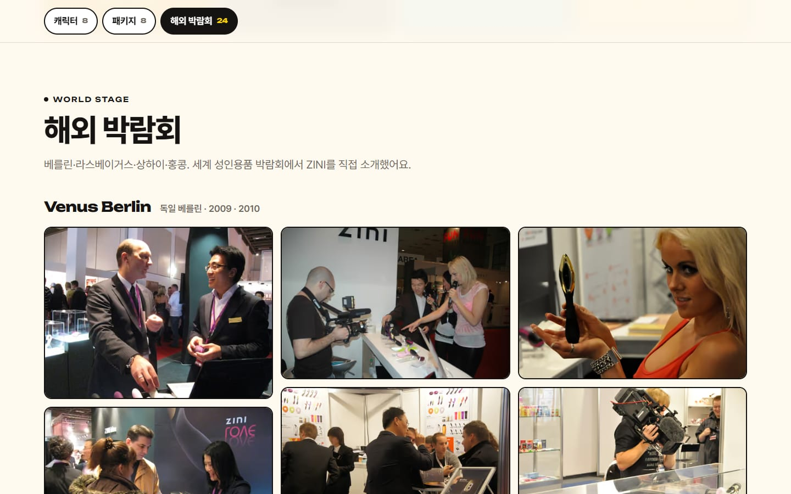<br><sub>갤러리 — 분류 탭 + 라이트박스</sub></td>
    <td></td>
  </tr>
</table>

<table>
  <tr>
    <td width="25%">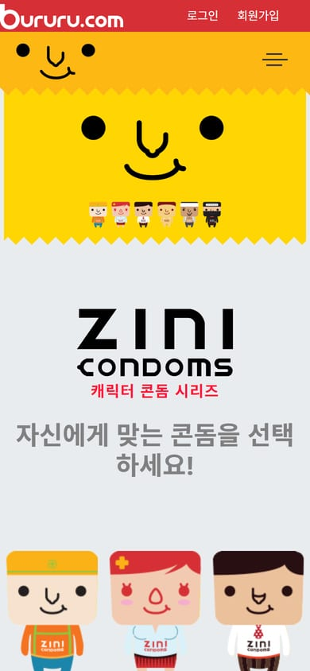<br><sub>2020 · 휴대폰</sub></td>
    <td width="25%">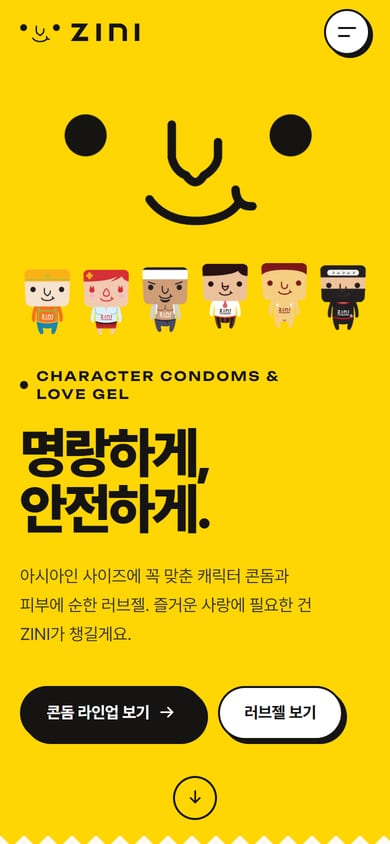<br><sub>2026 · 휴대폰</sub></td>
    <td width="25%">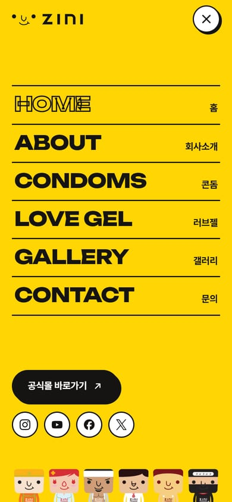<br><sub>전체 메뉴</sub></td>
    <td width="25%">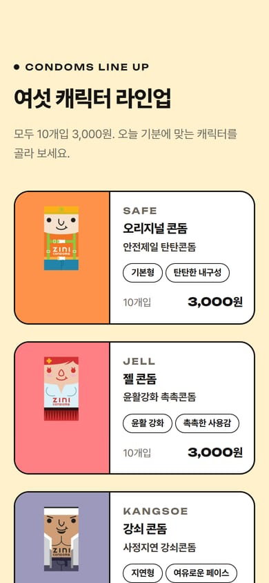<br><sub>휴대폰 전용 가로 카드</sub></td>
  </tr>
</table>

## 디자인 포인트

- **캐릭터 대표색 시스템** — 여섯 캐릭터 패키지 사진의 배경색(`#fe924a` SAFE, `#fe8084` JELL …)을 그대로 뽑아 토큰으로 만들었어요. 카드·섹션 배경이 사진 배경과 같아서 경계 없이 이어집니다.
- **원본 자산 살리기** — 2020년 SVG에서 ZINI 워드마크와 얼굴 로고 경로를 옮겨 컴포넌트로 만들었고, 콘돔 포장지처럼 톱니 모양으로 끝나는 섹션 경계를 브랜드 모티프로 썼어요.
- **명랑한 인터랙션** — 마우스를 따라오는 눈(터치 기기에서는 두리번), 주기적인 윙크, 캐릭터 고르기 탭, 흐르는 띠, 세어 올라가는 숫자, 페이지 전환(View Transitions).
- **진지한 정보** — Lorem ipsum을 모두 걷어내고, 원본 상세페이지 이미지에서 확인한 제품 특징·성분(6 NO ADDED, 히알루론산 등)으로 문구를 다시 썼어요. 근거 없는 수치는 넣지 않았습니다.

## 기술 포인트

- **글꼴 서브셋** — `scripts/subset-fonts.mjs`가 `src/` 안의 글자(주석 제외)만 모아 Pretendard·Unbounded를 잘라 냅니다. 쓰는 굵기(400~900)만 남겨 2 MB → 94 KB. `npm run dev` / `build` 전에 자동 실행돼요.
- **Astro Fonts API** — 로컬 글꼴을 preload하고, 대체 글꼴 크기 보정(size-adjust)까지 자동으로 붙여 CLS 0.
- **이미지** — `Img` 컴포넌트가 파일명만 받아 AVIF·WebP `<picture>`를 만듭니다. 파일명이 틀리면 빌드가 실패해요.
- **CSS** — `@layer reset, base, layout, components, utilities` + 컴포넌트 스코프 스타일. 유동 글자 크기(`clamp`), `color-mix`, `:has()`, `@starting-style`로 열고 닫히는 `<dialog>`.
- **JS 최소화** — Bootstrap·Swiper·jQuery를 모두 걷어냈어요. 남은 건 헤더·탭·카운터·폼 검증 같은 작은 스크립트(HTML에 인라인)와, 갤러리를 열 때만 받는 PhotoSwipe입니다.
- **접근성** — 탭 패턴(화살표·Home·End 키), `aria-current`, 폼 오류를 입력칸과 연결(`aria-describedby`), '동작 줄이기'를 켜면 모든 애니메이션·자동 흐름을 멈춥니다.

## 페이지

| 주소               | 내용                                                                            |
| ------------------ | ------------------------------------------------------------------------------- |
| `/`                | 히어로 · 왜 ZINI · 캐릭터 고르기 · SINCE 2008 · S-SOLUTION · 해외 박람회        |
| `/condom.html`     | 콘돔 특징 4가지 · 캐릭터 라인업 6종 · 생산·인증 · 패키지                        |
| `/gel.html`        | S-SOLUTION 소개 · 90% 물 · SAFETY / CLEAN / EFFECT · 라인업 10종                |
| `/sensual.html` 외 | 센슈얼 · 프리미엄 · 마사지젤 상세 — 추천 가이드 · 성분 · 원본 상세 이미지(접기) |
| `/about.html`      | 회사소개(케어앤셰어) — 강점 · 정식 수입 · 유통 채널 · 상품 파워 · 파트너        |
| `/gallery.html`    | 캐릭터 · 패키지 · 해외 박람회 사진(라이트박스)                                  |
| `/contact.html`    | 사업 분야 · 문의 폼                                                             |
| `/legacy/`         | 2020년 원본을 손대지 않고 그대로                                                |

## 시작하기

Node.js 22.23.4 이상이 필요합니다(Astro 7 요구 사항).

```bash
npm install
npm run dev      # http://localhost:4321/zini/
npm run build    # 글꼴 서브셋 → 타입 검사(astro check) → dist/ 빌드
npm run preview  # 빌드 결과 미리보기
npm run shots    # README 스크린샷 (preview를 띄운 상태에서, Chrome 필요)
npm run format   # Prettier 정리
```

## 폴더 구조

```
src/
├─ assets/
│  ├─ fonts/         서브셋 글꼴 (scripts/subset-fonts.mjs가 생성)
│  ├─ images/        이미지 원본 — 빌드할 때 AVIF·WebP·반응형 크기로 변환
│  └─ svg/           원본 로고·패턴
├─ components/
│  ├─ layout/        Header(전체 메뉴 <dialog> 포함), Footer
│  ├─ sections/      HomeHero, WhyZini, CharacterPicker, StatBand, GelShowcase, WorldStage,
│  │                 CtaBand, PageHero, CondomCard, GelCard, LineCard, FeatureCards,
│  │                 GelLineDetail, DetailFold, GalleryGrid, ContactForm
│  └─ ui/            Img, Icon, Wordmark, ZiniFace, Zigzag, Marquee, SectionHead,
│                    SpinBadge, SocialLinks, Lightbox
├─ data/             site · products · gallery · about
├─ layouts/          BaseLayout — <head>(SEO·OG·글꼴), 헤더·푸터
├─ lib/              images.ts(파일명으로 이미지 찾기), url.ts(base 경로)
├─ pages/            index · about · condom · gel · sensual · premium · massage · gallery · contact · 404
├─ scripts/          reveal.ts — 스크롤하면 나타나기
└─ styles/           global.css — 디자인 토큰 · 레이어 · 공용 컴포넌트
legacy/              2020년 원본 (빌드할 때 dist/legacy/로 복사)
scripts/             subset-fonts.mjs · shots.mjs
```

## 콘텐츠 수정

| 바꿀 내용                               | 파일                                         |
| --------------------------------------- | -------------------------------------------- |
| 콘돔·러브젤 이름 · 설명 · 가격 · 대표색 | `src/data/products.ts`                       |
| 메뉴 · 푸터 링크 · 소셜 · 쇼핑몰 주소   | `src/data/site.ts`                           |
| 회사소개 · 문의 페이지 사업 분야        | `src/data/about.ts`                          |
| 갤러리                                  | `src/data/gallery.ts` + `src/assets/images/` |

글자를 새로 쓰면 다음 `npm run dev` / `build` 때 글꼴에 자동으로 들어갑니다. 개발 서버를 켜 둔 채 바로 반영하려면 `npm run fonts`를 실행하세요.

### 문의 폼

기본은 **데모 모드**예요. 입력을 검증하고 "데모라 실제로 전송되지 않았다"는 안내만 보여 줍니다. `.env`에 `PUBLIC_CONTACT_ENDPOINT`(예: Formspree 주소)를 넣으면 그 주소로 JSON을 보내요. `.env.example`을 참고하세요.

## 배포

- **GitHub Pages** — `.github/workflows/deploy.yml`이 `master`에 푸시될 때마다 빌드해서 `/zini/` 아래에 올립니다(저장소 Settings → Pages → Source: **GitHub Actions**).
- **Vercel** — Vercel 빌드에서는 자동으로 도메인 루트(`/`)와 Vercel 주소를 씁니다(`VERCEL` 환경 변수로 감지). PR마다 만들어지는 미리보기도 그대로 열려요.
- 그 밖의 곳에 올릴 때는 `SITE_URL`, `BASE_PATH` 환경 변수로 주소를 정해요. 이 두 값이 있으면 항상 우선합니다.

## 참고

- 이 사이트는 **포트폴리오용 리디자인 작업물**이라 실제로 판매하지 않아요. "공식몰" 버튼은 부르르닷컴으로 연결됩니다(쇼핑몰은 성인 인증 첫 화면으로 이동해요).
- 2020년 원본 푸터의 회사 정보(계좌·사업자번호·주소 등)는 예시 값이라 리뉴얼에서는 회사명만 남겼습니다.
- 원본에 있던 다른 브랜드 상품 캐러셀과 쇼핑몰 이벤트 배너는 ZINI 브랜드와 직접 관련이 없어 뺐어요. `legacy/`에서 그대로 볼 수 있습니다.

## 출처

- 글꼴: [Pretendard](https://github.com/orioncactus/pretendard) · [Unbounded](https://fonts.google.com/specimen/Unbounded) (SIL Open Font License 1.1)
- 브랜드 아이콘: [Simple Icons](https://simpleicons.org/) (CC0 1.0)
- 라이트박스: [PhotoSwipe](https://photoswipe.com/) (MIT)
